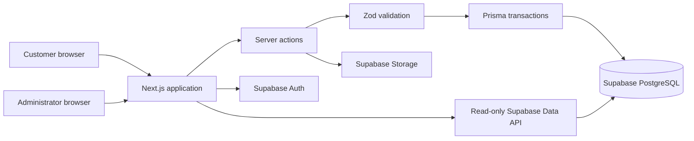

# BEPA architecture and engineering decisions

BEPA is a bilingual auto-parts storefront built with Next.js App Router, TypeScript and Prisma 7. Customers browse products, submit delivery orders for offline confirmation, and view their account history. Staff use Google OAuth and a server-protected administration area.

## System overview



## Trust boundaries

- **Authentication:** browser obtains a Supabase session; server calls `supabase.auth.getUser()` and checks the server-stored profile role for every privileged mutation.
- **Authorization:** browser-facing Supabase database roles have read-only table privileges; RLS restricts visible records. All business writes use authenticated server actions and trusted database credentials.
- **Checkout:** prices and stock are re-read from PostgreSQL. Each order is inserted and inventory decremented atomically, with conditional updates defending against concurrent overselling. `checkout_request_id` is unique, so retrying a committed request returns the prior order identifier instead of inserting twice. Monetary calculations use Prisma Decimal.
- **Fulfillment:** admins may move orders through defined states. Cancelling before shipping restores inventory in the same transaction; compare-and-swap makes overlapping cancellations safe. Returns and refunds on shipped goods are intentionally out of scope.
- **Media:** server-side admin uploads require an allowlisted MIME type, a compatible magic-byte signature, a 5 MiB size limit and server-only Storage credentials.
- **OAuth callbacks:** same-origin redirect targets are checked before passing paths to the browser.
- **Catalog reads:** pagination, filtering, selective indexes and cache invalidation minimize repeat reads.

## Tradeoffs and known limitations

- This is a single-storefront system, not a multi-tenant marketplace.
- Checkout places orders for confirmation; **no online payment processing is implemented**.
- The database schema references Supabase-managed `auth.users`; a fresh standalone PostgreSQL instance needs Supabase-compatible setup for full integration tests.
- Browser role permissions are applied only after executing the SQL against the live database. Static tests do not prove deployed RLS.
- User-generated reviews and customer records are stored in PostgreSQL; do not publish real customer data or production credentials.
- Offline CI focuses on validation, types, tests and build; real external authentication, storage and concurrency require staging integration tests.
- API abuse limiting, webhook-based payments, returns/refunds, recovery drills and production telemetry would be future work.

## Repository layout

- `src/app`: Next.js routes, pages and server actions
- `src/components`: reusable UI and storefront components
- `src/lib`: authentication, domain helpers, validation and data access
- `prisma`: ORM schema; `supabase/schema.sql`: database bootstrap, RLS and grants
- `tests`: dependency-light security and domain regression tests
- `.github/workflows/ci.yml`: offline quality gate

## Engineering validation

```bash
npm ci
npm run lint
npm run security:check
npm test
npm run build
npm run typecheck
```

A configured Supabase PostgreSQL instance additionally supports `npm run db:permissions`, a read-only audit of browser-role mutation privileges. See [security rollout](SECURITY.md).
